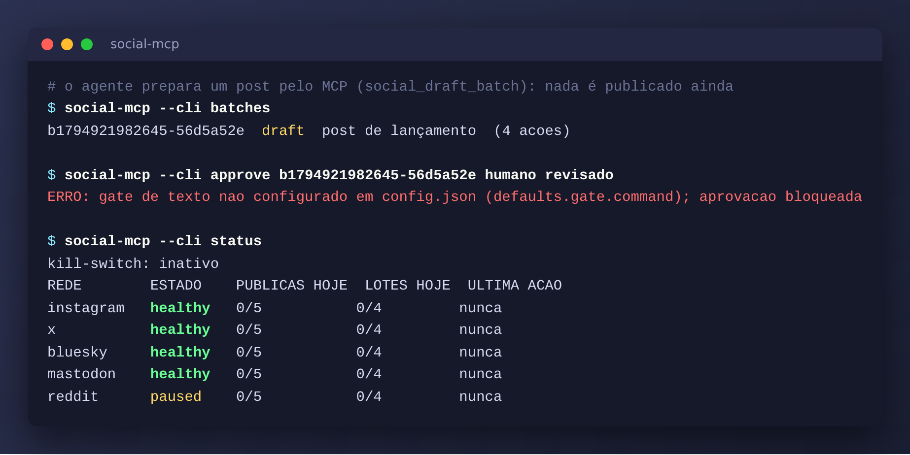

# Social MCP

[Português](README.md) · **English**

[](https://github.com/vitorcamillo/social-mcp/actions/workflows/ci.yml)   

Social MCP is an MCP server in Java 21 that operates social network sessions in a real desktop Chrome via [javaDriveless](https://github.com/vitorcamillo/javaDriveless). It serves developers and operators who need AI agents to read pages and prepare action drafts. Its distinguishing trait is that every public action goes through per-network quotas, explicit terminal approval, and a local kill switch.



*A post draft created by the MCP sits idle: with no text gate configured, approval is blocked and nothing is published.*

## Contents

- [Features](#features)
- [Quickstart](#quickstart)
- [Usage](#usage)
- [Configuration](#configuration)
- [How it works](#how-it-works)
- [Limitations and responsible use](#limitations-and-responsible-use)
- [Contributing](#contributing)
- [License](#license)

## Features

- Publish only with human review: public actions run only after explicit approval via `--cli approve`, validated by an external text gate.
- Keep control on the local host: global kill switch, per-network states (`healthy`, `cooldown`, `paused`, `banned`), and an append-only journal for auditing.
- Operate each network in isolation: one persistent Chrome profile per network, with daily quotas and a minimum interval between public actions.
- Catch blocks early: the anti-bot tripwire moves the network to `cooldown` automatically when it finds blocking patterns on the page.
- Prove each batch result: strong reconciliation with `capture_ids` before sending plus `verify_new_id` after, or state verification before and after.
- Reuse ready-made flows: high-level recipe actions (`social_action`) and a read-only probe (`social_probe`) before drafting batches.

## Quickstart

Requirements:

- Java 21 and Maven 3.9+
- Google Chrome with a usable desktop display (`DISPLAY` on Linux)
- The `io.github.vitorcamillo:javadriveless` dependency resolved from Maven Central; building javaDriveless locally is optional

```bash
git clone https://github.com/vitorcamillo/social-mcp.git
cd social-mcp
mvn -B -ntp package
./bin/social-mcp --cli status
```

Maven downloads javaDriveless from Maven Central. Alternatively, build it from source (`mvn -B -ntp install` in its repository) or use `scripts/install-javadriveless-public.sh`, which installs an artifact with verified origin and hashes.

Server mode is the argument-free invocation: `./bin/social-mcp` speaks JSON-RPC over stdio. Generic registration example in an MCP client:

```json
{"mcpServers": {"social-mcp": {"command": "/absolute/path/social-mcp/bin/social-mcp"}}}
```

By default, the launcher stores state in `~/.social-mcp-public`. Set `SOCIAL_MCP_HOME` to an isolated directory when running tests or more than one installation. To pin the directory of an installation without editing the launcher, write the absolute path on the first line of `~/.config/social-mcp/home`; the environment variable, when set, takes precedence. The directory holds configuration, journal entries, batches, screenshots, and browser profiles; never share or version it.

## Usage

Approver CLI (`bin/social-mcp --cli <command>`):

| Command | Description |
|---|---|
| `status` | Shows the kill switch, the known networks, today's quotas, and the last public action. |
| `batches` | Lists batches and their states (`draft`, `approved`, `executed`, `rejected`). |
| `approve` | Approves a batch after the gate and records the caller-provided role (`humano` or `orquestrador`); `--forcar` and `--ensaio` require the owner in an interactive terminal with `CONFIRMO`. |
| `reject` | Rejects a draft or revokes an approved batch. |
| `state` | Sets a network state (`healthy`, `cooldown`, `paused`, `banned`); reactivating (`healthy`) requires the owner in an interactive terminal. |
| `stop` | Turns the global kill switch on or off (`on` or `off`). |
| `import-cookies` | Imports a JSON cookie file into a network's persistent session. |
| `validar-receitas` | Validates recipes with example parameters without writing anything and without spending quota. |
| `journal` | Shows the latest journal events. |
| `sessao` | Shows which networks are logged in, by cookie name and expiry (never the value); with `<network>`, checks only that one. |
| `login` | Opens the Chrome of the network profile, through the same configured proxy, so the owner can sign in; when Chrome is closed, it checks the session. |

MCP tools (JSON-RPC over stdio):

| Tool | Description |
|---|---|
| `social_status` | Network states, kill switch, today's quotas, and last public action; check before planning actions. |
| `social_browse` | Opens a URL in the network's persistent session and returns title, URL, and visible text; read-only. |
| `social_read` | Reads the visible text of the network's current page, without navigating. |
| `social_inspect` | Lists the visible interactive controls of the current page, with ready-to-use selectors; read-only. |
| `social_query` | Counts elements matching a selector and returns key attributes and ancestry; read-only. |
| `social_screenshot` | Saves a PNG of the network's current screen and returns the file path. |
| `social_probe` | Runs only the recipe's read steps and checks the first action control, without clicking or typing. |
| `social_action` | Runs recipe read-only actions immediately; public actions become batch drafts. |
| `social_draft_batch` | Creates and validates a draft batch for one network, without executing it. |
| `social_execute_batch` | Executes an approved batch; fails without approval, with the kill switch on, or without quota and spacing. |
| `social_set_network_state` | Moves the network to `cooldown` or `paused`; never reactivates (`healthy` is the owner's CLI decision). |
| `social_find_duplicates` | Groups profile posts with similar captions to confirm duplicates; read-only. |
| `social_resolve_incerteza` | Records what the on-network check showed for a batch with uncertain delivery and releases the lock. |
| `social_journal_tail` | Returns the latest journal events. |

## Configuration

By default, no gate command is configured. Approval fails closed until you configure a local gate in `config.json`, under `defaults.gate.command`. The command receives `pre --batch <path> --config <path> --json` and must write a JSON object such as `{"resultado":"PASS"}` (or `WARN`/`FAIL`) and return a compatible exit status. Keep the gate executable local and review its code before use. After reviewing the full draft, approve it explicitly:

```bash
./bin/social-mcp --cli approve <batch-id> humano "reviewed"
```

There is no sample gate that approves everything. CLI approval records the caller-provided role (`humano` or `orquestrador`); it does not act as an identity provider.

## How it works

1. The agent reads pages with the read-only tools and prepares public actions in a batch (`social_draft_batch` or `social_action`), which returns a `batchId` with a guard preflight.
2. The external text gate evaluates the batch; with no gate configured, approval is blocked.
3. The single approver (the owner, or the active orchestrator watching the operation) approves in the terminal; with no orchestrator watching, the batch waits for human approval.
4. The operator executes the approved batch (`social_execute_batch`), honoring quotas, spacing, and human pacing between steps, with everything recorded in the journal.
5. Any detected anti-bot pattern moves the network to `cooldown` and aborts the batch; reactivation requires the owner in an interactive terminal.

## Limitations and responsible use

- This project does not bypass CAPTCHAs, anti-spam systems, account restrictions, or platform rules. Use it only with accounts you control and follow each platform's terms.
- CLI approval authenticates nobody: an MCP client or agent with shell access can call the CLI, so protect the host, operating system permissions, and the `SOCIAL_MCP_HOME` directory.
- Session cookies are never part of this repository: log in interactively in the profile owned by the user or import a session file they provide, and protect the runtime directory.
- The public code holds only synthetic tests. It holds no account, browser profile, cookie export, proxy credential, marketing plan, or hosted service.
- The stdio transport and CLI approval are not an authentication boundary; the server is designed for a trusted local host.

## Contributing

See [CONTRIBUTING.md](CONTRIBUTING.md) and include a focused test for behavior changes, without sending runtime data, cookies, tokens, or account identifiers. Reports about potential security issues must follow [SECURITY.md](SECURITY.md).

## License

This project is distributed under the MIT License. See [LICENSE](LICENSE).
