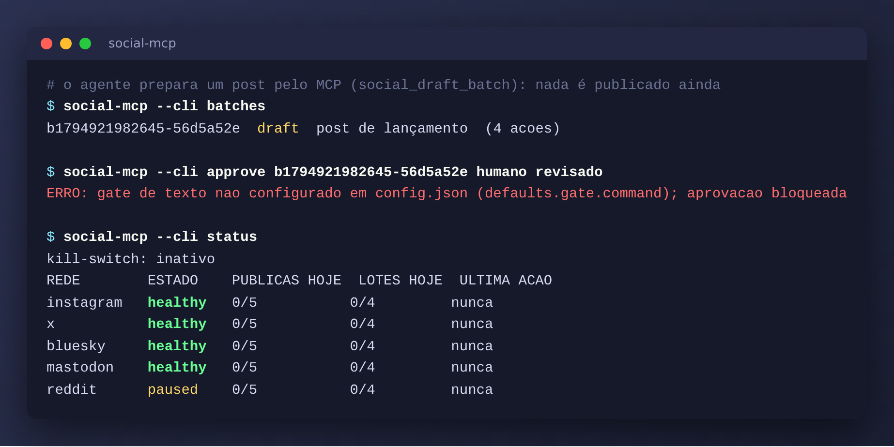

# Social MCP

**Português** · [English](README.en.md)

[](https://github.com/vitorcamillo/social-mcp/actions/workflows/ci.yml)   

O Social MCP é um servidor MCP em Java 21 que opera sessões de redes sociais em um Chrome desktop real por meio do [javaDriveless](https://github.com/vitorcamillo/javaDriveless). Ele atende desenvolvedores e operadores que precisam que agentes de IA leiam páginas e preparem rascunhos de ações. O diferencial é que toda ação pública passa por cotas por rede, aprovação explícita no terminal e um kill switch local.



*Um rascunho de post criado pelo MCP fica parado: sem gate de texto configurado, a aprovação é bloqueada e nada é publicado.*

## Sumário

- [Recursos](#recursos)
- [Início rápido](#início-rápido)
- [Uso](#uso)
- [Configuração](#configuração)
- [Como funciona](#como-funciona)
- [Limitações e uso responsável](#limitações-e-uso-responsável)
- [Contribuição](#contribuição)
- [Licença](#licença)

## Recursos

- Publique somente com revisão humana: ações públicas só executam após aprovação explícita via `--cli approve`, validada por um gate de texto externo.
- Mantenha o controle no host local: kill switch global, estados por rede (`healthy`, `cooldown`, `paused`, `banned`) e journal somente de acréscimo para auditoria.
- Opere cada rede de forma isolada: um perfil de Chrome persistente por rede, com cotas diárias e intervalo mínimo entre ações públicas.
- Detecte bloqueios cedo: o tripwire de anti-bot coloca a rede em `cooldown` automaticamente ao encontrar padrões de bloqueio na página.
- Prove o resultado de cada lote: conferência forte com `capture_ids` antes do envio mais `verify_new_id` depois, ou verificação de estado antes e depois.
- Reaproveite fluxos prontos: ações de alto nível por receita (`social_action`) e sonda somente leitura (`social_probe`) antes de rascunhar lotes.

## Início rápido

Requisitos:

- Java 21 e Maven 3.9+
- Google Chrome com um display desktop utilizável (`DISPLAY` no Linux)
- Dependência `io.github.vitorcamillo:javadriveless` resolvida pelo Maven Central; compilar o javaDriveless localmente é opcional

```bash
git clone https://github.com/vitorcamillo/social-mcp.git
cd social-mcp
mvn -B -ntp package
./bin/social-mcp --cli status
```

O Maven baixa o javaDriveless do Maven Central. Como alternativa, compile-o a partir do fonte (`mvn -B -ntp install` no repositório dele) ou use `scripts/install-javadriveless-public.sh`, que instala um artefato com origem e hashes verificados.

O modo servidor é a execução sem argumentos: `./bin/social-mcp` fala JSON-RPC por stdio. Exemplo genérico de registro em um cliente MCP:

```json
{"mcpServers": {"social-mcp": {"command": "/caminho/absoluto/social-mcp/bin/social-mcp"}}}
```

Por padrão, o launcher armazena o estado em `~/.social-mcp-public`. Defina `SOCIAL_MCP_HOME` para um diretório isolado ao executar testes ou mais de uma instalação. Para fixar o diretório de uma instalação sem editar o launcher, grave o caminho absoluto na primeira linha de `~/.config/social-mcp/home`; a variável de ambiente, quando definida, tem prioridade. O diretório contém configuração, entradas do journal, lotes, screenshots e perfis do navegador; nunca o compartilhe nem o versione.

## Uso

CLI do aprovador (`bin/social-mcp --cli <comando>`):

| Comando | Descrição |
|---|---|
| `status` | Mostra o kill switch, as redes conhecidas, as cotas de hoje e a última ação pública. |
| `batches` | Lista os lotes e seus estados (`draft`, `approved`, `executed`, `rejected`). |
| `approve` | Aprova um lote após o gate e registra o papel informado (`humano` ou `orquestrador`); `--forcar` e `--ensaio` exigem o dono em terminal interativo com `CONFIRMO`. |
| `reject` | Rejeita um rascunho ou revoga um lote aprovado. |
| `state` | Define o estado de uma rede (`healthy`, `cooldown`, `paused`, `banned`); reativar (`healthy`) exige o dono em terminal interativo. |
| `stop` | Liga ou desliga o kill switch global (`on` ou `off`). |
| `import-cookies` | Importa um arquivo JSON de cookies para a sessão persistente de uma rede. |
| `validar-receitas` | Valida as receitas com parâmetros de exemplo sem gravar nada e sem gastar cota. |
| `journal` | Mostra os últimos eventos do journal. |
| `sessao` | Mostra quais redes estão logadas, por nome e validade dos cookies (nunca o valor); com `<rede>`, verifica só aquela. |
| `login` | Abre o Chrome do perfil da rede, pelo mesmo proxy configurado, para o dono entrar na conta; ao fechar o Chrome, verifica a sessão. |

Ferramentas MCP (transporte JSON-RPC por stdio):

| Ferramenta | Descrição |
|---|---|
| `social_status` | Estado das redes, kill switch, cotas de hoje e última ação pública; consulte antes de planejar ações. |
| `social_browse` | Abre uma URL na sessão persistente da rede e devolve título, URL e texto visível; somente leitura. |
| `social_read` | Lê o texto visível da página atual da rede, sem navegar. |
| `social_inspect` | Lista os controles interativos visíveis da página atual, com seletores prontos; somente leitura. |
| `social_query` | Conta os elementos que casam um seletor e devolve atributos-chave e ancestralidade; somente leitura. |
| `social_screenshot` | Salva um PNG da tela atual da rede e devolve o caminho do arquivo. |
| `social_probe` | Executa só os passos de leitura da receita e confere o primeiro controle de ação, sem clicar nem digitar. |
| `social_action` | Executa na hora ações somente leitura da receita; ações públicas viram rascunho de lote. |
| `social_draft_batch` | Cria e valida um rascunho de lote de uma rede, sem executar. |
| `social_execute_batch` | Executa um lote aprovado; falha sem aprovação, com kill switch ativo ou sem cota e espaçamento. |
| `social_set_network_state` | Coloca a rede em `cooldown` ou `paused`; nunca reativa (`healthy` é decisão do dono via CLI). |
| `social_find_duplicates` | Agrupa publicações do perfil com legenda parecida para confirmar duplicatas; somente leitura. |
| `social_resolve_incerteza` | Registra o que a conferência na rede mostrou para um lote com envio incerto e libera a trava. |
| `social_journal_tail` | Devolve os últimos eventos do journal. |

## Configuração

Por padrão, não há comando de gate configurado. A aprovação falha de forma fechada até que você configure um gate local em `config.json`, dentro de `defaults.gate.command`. O comando recebe `pre --batch <path> --config <path> --json` e deve escrever um objeto JSON como `{"resultado":"PASS"}` (ou `WARN`/`FAIL`) e retornar um status de saída compatível. Mantenha o executável do gate local e revise seu código antes de usá-lo. Depois de revisar o rascunho completo, aprove-o explicitamente:

```bash
./bin/social-mcp --cli approve <batch-id> humano "reviewed"
```

Não existe um gate de exemplo que aprove tudo. A aprovação pelo CLI registra o papel informado por quem chama (`humano` ou `orquestrador`); ela não funciona como um provedor de identidade.

## Como funciona

1. O agente lê páginas com as ferramentas somente leitura e prepara ações públicas em um lote (`social_draft_batch` ou `social_action`), que devolve um `batchId` com preflight da guarda.
2. O gate de texto externo avalia o lote; sem gate configurado, a aprovação é bloqueada.
3. O aprovador único (o dono ou o orquestrador ativo que está acompanhando a operação) aprova no terminal; sem orquestrador acompanhando, o lote aguarda aprovação humana.
4. A operadora executa o lote aprovado (`social_execute_batch`), respeitando cotas, espaçamento e ritmo humano entre passos, com tudo registrado no journal.
5. Qualquer padrão de anti-bot detectado coloca a rede em `cooldown` e aborta o lote; a reativação exige o dono em terminal interativo.

## Limitações e uso responsável

- Este projeto não contorna CAPTCHAs, sistemas antispam, restrições de contas nem regras de plataformas. Use-o somente com contas que você controla e siga os termos de cada plataforma.
- A aprovação pelo CLI não autentica ninguém: um cliente MCP ou agente com acesso ao shell pode chamar o CLI, portanto proteja o host, as permissões do sistema operacional e o diretório `SOCIAL_MCP_HOME`.
- Cookies de sessão nunca fazem parte deste repositório: faça login interativamente no perfil pertencente ao usuário ou importe um arquivo de sessão fornecido por ele, e proteja o diretório de runtime.
- O código público contém somente testes sintéticos. Ele não contém conta, perfil de navegador, exportação de cookies, credencial de proxy, plano de marketing nem serviço hospedado.
- O transporte stdio e a aprovação pelo CLI não são uma fronteira de autenticação; o servidor foi projetado para um host local confiável.

## Contribuição

Consulte [CONTRIBUTING.md](CONTRIBUTING.md) e inclua um teste focado para mudanças de comportamento, sem enviar dados de runtime, cookies, tokens ou identificadores de contas. Relatos sobre possíveis problemas de segurança devem seguir [SECURITY.md](SECURITY.md).

## Licença

Este projeto é distribuído sob a Licença MIT. Consulte [LICENSE](LICENSE).
